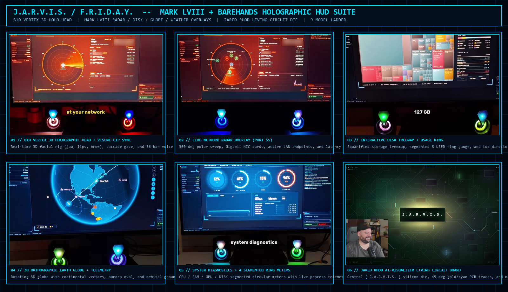
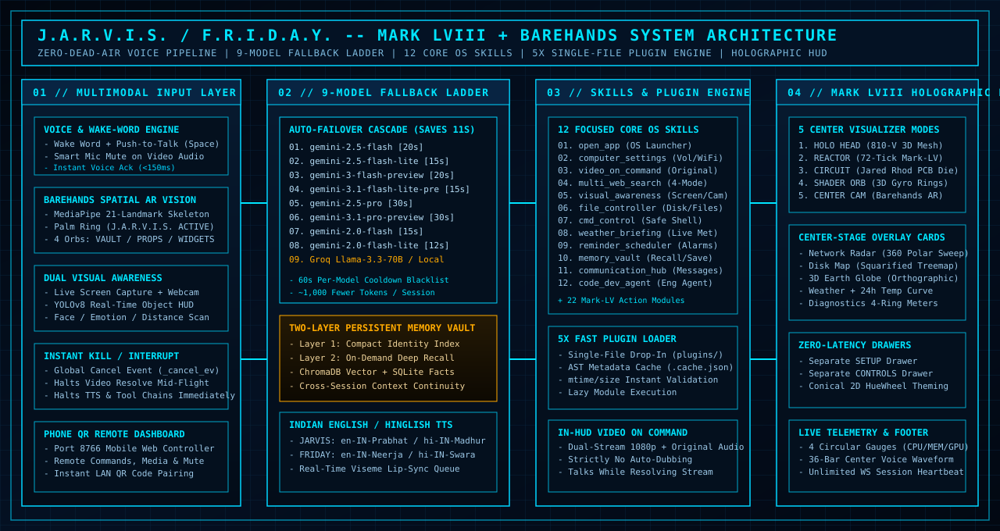
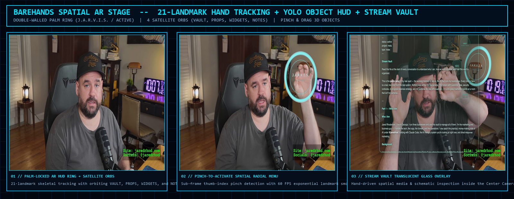

# J.A.R.V.I.S. / F.R.I.D.A.Y. -- Mark LVIII + Barehands Spatial AI Operating System



**J.A.R.V.I.S. (Just A Rather Very Intelligent System) & F.R.I.D.A.Y.** is a full-stack, multimodal desktop AI operating system and holographic HUD engineered in Python and HTML5/WebGL Canvas. It fuses the **Mark LV / Mark LVIII** holographic interface architecture with **Barehands** 21-landmark spatial hand-tracking AR, a **9-Model Gemini Fallback Ladder**, **12 Focused Core OS Skills**, a **5x Faster Single-File Plugin Engine**, **In-HUD Original-Language Video Playback with Smart Mic Mute**, and a **Two-Layer Persistent Memory Vault**.

---

## Visual Overview

### 1. System Architecture Blueprint



### 2. Barehands Spatial AR Stage & Center Camera Vision



---

## Core Engineering Highlights

### 1. Media, Voice & Real-Time Interaction
- **Video on Command (In-HUD Original-Language Playback):** Play any YouTube URL, local media file, or natural-language description (for example, `"play the new Dune trailer"`) directly inside the holographic HUD overlay (`#hud-video-overlay`). Uses `yt-dlp` with `language!=auto` audio stream selection and dual-stream `<video>` + `<audio>` synchronization for 1080p playback in the video's original language (strictly zero random auto-dubbing).
- **Talks While It Loads (Zero Dead Air):** J.A.R.V.I.S. speaks an immediate natural acknowledgement (`"On it, Sir."` / `"Pulling that up right away, Sir."`) while video streams or complex tools resolve asynchronously in the background. Saying `"stop"` or `"cancel"` trips the global `_cancel_ev` interrupt flag and aborts background resolution before the video overlay even opens.
- **Smart Mic Mute:** Whenever the in-HUD video player outputs audio, the HUD automatically signals `{action: "video_audio_state", playing: true}` over WebSocket, engaging `_video_audio_playing` in the voice loop so the microphone mutes itself and J.A.R.V.I.S. never talks back to movie dialogue.
- **Authentic Indian English, Hindi & Hinglish Voice Engine:**
  - **J.A.R.V.I.S. (Male):** `en-IN-PrabhatNeural` (Indian English) and `hi-IN-MadhurNeural` (Hindi / Devanagari).
  - **F.R.I.D.A.Y. (Female):** `en-IN-NeerjaNeural` (Expressive Indian English) and `hi-IN-SwaraNeural` (Hindi / Devanagari).
  - Automatic script detection seamlessly switches voices mid-conversation while streaming real-time phoneme viseme weights to the 3D Holographic Head.

---

### 2. 9-Model Gemini Fallback Ladder & Lean Core
If any Gemini model is rate-limited (`429`), overloaded (`503`), or times out, [`MarkLVBridge`](modules/mark_lv_bridge.py) automatically cascades across a 9-model ladder with per-model timeouts and a 60-second cooldown blacklist, saving up to 11 seconds per failed call and preventing UI hangs:

| Priority | Model Identifier | Timeout | Role in Cascade |
| :--- | :--- | :--- | :--- |
| **01** | `gemini-2.5-flash` | `20s` | Primary low-latency multimodal tool router |
| **02** | `gemini-2.5-flash-lite` | `15s` | High-speed secondary flash tier |
| **03** | `gemini-3-flash-preview` | `20s` | Next-gen preview flash reasoning |
| **04** | `gemini-3.1-flash-lite-preview` | `15s` | Ultra-fast preview fallback |
| **05** | `gemini-2.5-pro` | `30s` | Deep reasoning & complex code synthesis |
| **06** | `gemini-3.1-pro-preview` | `30s` | High-complexity analytical fallback |
| **07** | `gemini-2.0-flash` | `15s` | Secondary stable flash generation |
| **08** | `gemini-2.0-flash-lite` | `12s` | Lightweight emergency cloud fallback |
| **09** | `Groq Llama-3.3-70B / Ollama` | `15s` | Independent cloud/local offline failover |

- **Leaner Prompt & Tool Declarations (~1,000 Fewer Tokens/Session):** Core OS control is consolidated into **12 Focused Core Skills** + dynamically discovered single-file plugins + two-layer memory index injection, cutting ~1,000 tokens per turn while preserving all 22+ legacy Mark-LV action handlers via `_LEGACY_ACTION_ALIASES`.

---

### 3. Mark LVIII Holographic HUD & 5 Center Visualizers
The HUD ([`hud.html`](hud.html)) provides five real-time interactive center-stage modes selectable from the top bar:

1. **`HOLO HEAD` (810-Vertex 3D Human Holographic Mesh):**
   - Ported from the Mark-LV 3D anatomical rig ([`assets/head_mesh.js`](assets/head_mesh.js)): **810 3D vertices, 1,554 flat-shaded back-face-culled triangles, and 788 depth-graded wireframe edges**.
   - Features anatomical eye sockets with saccade gaze drift, periodic eyelid blinks, vertical holographic scan planes, interactive mouse-drag yaw/pitch rotation, and real-time phoneme viseme lip-sync (`jaw`, `lips`, `brow` vertex weights).
2. **`REACTOR` (Mark-LV 72-Graduation Arc Reactor Core):**
   - Multi-ring counter-rotating turbine blades, 72 degree-graduation ticks (`000` / `090` / `180` / `270`), radial energy spokes, and audio-modulated core bloom.
3. **`CIRCUIT` (Jared Rhod `ai-visualizer` Living Circuit Board):**
   - Central `[ J . A . R . V . I . S . ]` microprocessor package with 48 perimeter gold contact pins, 45-degree Manhattan-routed PCB traces (`JP34`, `JP72`, `Q34`, `R85`, `U86`), auxiliary IC chips, and glowing data packets that race inward on user speech and burst outward when J.A.R.V.I.S. responds.
4. **`SHADER ORB` (3D Gyroscopic Particle Sphere):**
   - 3D Fibonacci-lattice particle sphere surrounded by three orthogonal gyroscopic orbital rings with Barehands hand-pinch rotation and zoom.
5. **`CENTER CAM` (Barehands Spatial AR Stage + Live Vision):**
   - Brings the live camera feed to the center stage with simultaneous **YOLOv8 object detection reticles**, **face/emotion/distance HUD overlays**, and the **Barehands Spatial AR Palm Ring** (`J.A.R.V.I.S. / ACTIVE`) surrounded by 4 interactive satellite orbs (`VAULT`, `PROPS`, `WIDGETS`, `NOTES`) and the translucent `Stream Vault` glass overlay.

---

### 4. Mark LVIII Center-Stage Holographic Overlays
Triggered by voice, tool calls, or the top bar (`RADAR`, `DISK`, `GLOBE`, `WEATHER`, `DIAG`), `#hud-card-overlay` renders full center-stage interactive cards framed by corner L-brackets:
- **`NETWORK RADAR` (`network_radar`):** 360-degree rotating polar radar sweep, plotted LAN/WAN endpoints, Gigabit NIC status cards, active device table, and scrolling latency sparkline.
- **`DISK MAP` (`disk_map`):** Interactive squarified storage treemap canvas, segmented circular `% USED` ring gauge, and largest directory allocation bars.
- **`3D EARTH GLOBE` (`earth_globe`):** Interactive orthographic 3D globe with continental landmass polygons, latitude/longitude graticule, northern aurora oval, inclined orbital ground track, seismic epicenter rings, and drag/zoom controls.
- **`WEATHER TELEMETRY` (`weather`):** Live meteorological readout, 2x3 atmospheric sensor grid (`FEELS LIKE`, `HUMIDITY`, `WIND`, `UV INDEX`, `PRESSURE`, `VISIBILITY`), 24-hour temperature curve canvas, and 7-day forecast strip.
- **`SYSTEM DIAGNOSTICS` (`diagnostics`):** Four segmented circular ring meters (`CPU`, `RAM`, `GPU`, `DISK`), rolling 60-second CPU history waveform, and top active process table.

---

### 5. Instant Separate Drawers & Live Conical HueWheel Theming
- **Zero-Latency `SETUP` Drawer (`#setup-drawer`):** Dedicated right-side slide-out drawer for configuring API keys (`GEMINI_API_KEY`, `GROQ_API_KEY`, `OPENWEATHER_API_KEY`), viewing the 9-Model Fallback Ladder status, and inspecting loaded single-file plugins.
- **Zero-Latency `CONTROLS` Drawer (`#controls-drawer`):** Dedicated left-side slide-out drawer with instant switches for Persona (`J.A.R.V.I.S.` / `F.R.I.D.A.Y.`), Wake Word (`ON` / `OFF`), Hold-to-Talk (`SPACE`), Smart Mic Mute, Continuous Vision (`SCREEN + CAM`), Center Stage Mode, 8 Instant Theme Swatches (`CYAN`, `GOLD`, `FRIDAY`, `EMERALD`, `VIOLET`, `CRIMSON`, `ARCTIC`, `AMBER`), and Quick Action launchers.
- **2D Conical HueWheel Customizer (`THEME` Modal):** Full 360-degree HSV conical color wheel canvas (`#conical-hue-wheel`) that updates all HUD CSS variables and 3D canvas shaders (`--cyan`, `--gold`, `--bg`) in real time at 60 FPS.

---

### 6. Fast Single-File Plugin System (5x Faster Loading)
Drop any single `.py` file into [`plugins/`](plugins/) to unlock a new skill automatically:
- [`modules/plugin_loader.py`](modules/plugin_loader.py) uses an AST/metadata cache (`plugins/.plugin_cache.json`) keyed by file `mtime` and `size` so unchanged plugins load **5x faster** without re-importing heavy dependencies at startup.
- Built-in plugins included out of the box:
  - [`plugins/network_radar.py`](plugins/network_radar.py) -- Live 360-degree LAN/WAN radar sweep, active interface telemetry, and latency diagnostics.
  - [`plugins/disk_analyzer.py`](plugins/disk_analyzer.py) -- Squarified storage treemap and largest directory space analyzer.
  - [`plugins/earth_globe.py`](plugins/earth_globe.py) -- Interactive 3D orthographic Earth telemetry, orbital track, and coordinate locator.
  - [`plugins/hardware_schematic.py`](plugins/hardware_schematic.py) -- Interactive 3D holographic hardware schematic viewer inside the HUD.
  - [`plugins/pomodoro.py`](plugins/pomodoro.py) -- Focus timer and deep-work sprint session manager.
  - [`plugins/_template.py`](plugins/_template.py) -- Ready-to-copy starter template for single-file skill creation.

#### Authoring a New Plugin in 15 Lines
```python
PLUGIN_META = {
    "name": "custom_skill",
    "description": "Run a custom diagnostic or automation task.",
    "parameters": {
        "target": {"type": "STRING", "description": "Target name or resource", "required": True}
    },
}

def execute(parameters: dict, player=None, session_memory=None) -> str:
    target = parameters.get("target", "default")
    return f"Custom skill executed on {target}."
```

---

## Repository Structure

```text
D:\JARVIS
|-- jarvis_master.py               # Master orchestrator, voice loop, PyWebView HUD & WebSocket server
|-- hud.html                       # Mark LVIII + Barehands Holographic HUD (3D Head, Overlays, AR)
|-- memory_engine.py               # ChromaDB vector store + SQLite persistent memory engine
|-- vision_sensor.py               # YOLOv8 object detection, OCR, face & distance vision engine
|-- requirements.txt               # Python package dependencies
|-- assets/
|   |-- head_mesh.js               # 810-vertex, 1,554-triangle, 788-edge 3D Holographic Head mesh
|   |-- hud_mark_lviii_preview.png # 6-panel visual showcase of the Mark LVIII HUD
|   |-- barehands_ar_preview.png   # Barehands Spatial AR & Center Camera visual showcase
|   `-- architecture_diagram.svg   # System architecture vector blueprint
|-- modules/
|   |-- mark_lv_bridge.py          # 9-Model Gemini Fallback Ladder, 12 Core Skills & Video Resolver
|   |-- plugin_loader.py           # 5x Fast mtime-cached single-file plugin loader
|   |-- remote_dashboard.py        # Mobile Remote Dashboard HTTP server + QR Code generator
|   |-- system_control.py          # OS volume, brightness, WiFi, process & power control
|   |-- tts_engine.py              # Indian English / Hindi / Hinglish neural TTS & viseme dispatcher
|   `-- world_intel.py             # Multi-mode web search (news / research / price / compare) & briefings
|-- plugins/                       # Drop-in single-file skills (auto-discovered on startup)
`-- memory/                        # Two-layer persistent memory vault (MEMORY.md + SQLite + Chroma)
```

---

## Installation & Quick Start

### 1. Environment Setup
```powershell
git clone https://github.com/Pranshu125/J.A.R.V.I.S.git
cd J.A.R.V.I.S
python -m venv venv
.\venv\Scripts\activate
pip install -r requirements.txt
```

### 2. Configure API Keys
Create a `.env` file in the project root (or configure keys directly inside the HUD `SETUP` drawer at runtime):
```ini
GEMINI_API_KEY=your_gemini_api_key_here
GROQ_API_KEY=your_optional_groq_key_here
OPENWEATHER_API_KEY=your_optional_openweather_key_here
```

### 3. Launch J.A.R.V.I.S. Mark LVIII
```powershell
.\venv\Scripts\python.exe jarvis_master.py
```

---

## Keyboard, Voice & Spatial Gesture Reference

| Input / Control | Action |
| :--- | :--- |
| **`Spacebar` (Hold)** | Push-to-Talk voice capture while held; releases to dispatch immediately |
| **`"Jarvis ..."` / `"Friday ..."`** | Hands-free Wake Word activation |
| **`"Stop"` / `"Cancel"` / `KILL` Button** | Instant mid-flight cancellation of active TTS, tool execution, or video loading |
| **`HOLO HEAD` / `REACTOR` / `CIRCUIT` / `SHADER ORB` / `CENTER CAM`** | Switch Center Visualizer mode in real time |
| **`RADAR` / `DISK` / `GLOBE` / `WEATHER` / `DIAG`** | Open interactive Mark LVIII center-stage holographic telemetry overlays |
| **Thumb + Index Pinch (`Barehands`)** | Grab and rotate the 3D Holographic Head / Orb, or select an orbiting AR palm node (`VAULT`, `PROPS`, `WIDGETS`, `NOTES`) |
| **Open Palm (5 Fingers)** | Expand the holographic visualizer / open the Barehands `J.A.R.V.I.S. / ACTIVE` palm ring |
| **Closed Fist (0 Fingers)** | Collapse active spatial overlay / return orb to compact idle state |
| **`QR REMOTE` Top-Bar Button** | Display scannable LAN QR code to control J.A.R.V.I.S. from any smartphone browser |

---

## Credits & Architectural Inspiration
- **FatihMakes (`Mark-LV` / `Mark-LVIII`):** 810-vertex 3D holographic head rig, phoneme viseme lip-sync engine, 9-model Gemini fallback ladder, dual-stream original-language video player, and center-stage telemetry overlays.
- **Jared Rhod (`Barehands`, `fullstack-agent`, `ai-memory-vault`, `ai-visualizer`):** 21-landmark spatial hand tracking, palm-locked AR radial menu (`VAULT`, `PROPS`, `WIDGETS`, `NOTES`), living PCB silicon die visualizer, and two-layer persistent memory architecture.
